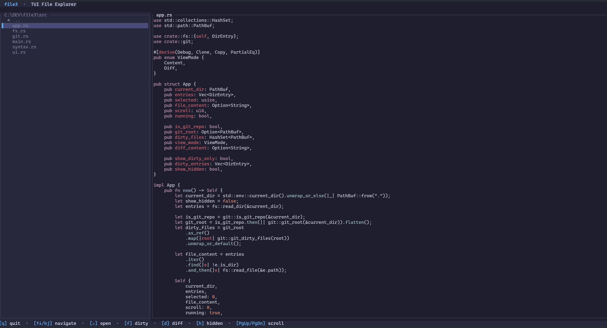

# file3

A fast terminal app for **reading** code: a VS Code–style explorer, file preview with syntax
highlighting, go-to-file and search across the whole project. It does not edit files.



## Install

```bash
# Install once (makes file3 available globally)
cargo install --path .
# Reinstall
cargo install --path . --force
# Or
cargo uninstall file3
cargo install --path .

# Run (in the folder you want to browse)
file3

# Or run without installing
cargo run
```

## Features

**Explorer**

- The whole project as a tree; folders expand with a click, `Enter` or `→`
- Moving through the tree previews the file on the right
- Respects `.gitignore` (`node_modules`, `target`, … stay out of the way); `h` shows them, dimmed
- Drag the border between the panels to resize the explorer
- **Updates by itself** when files change on disk (for example while an AI agent edits them):
  the tree, the open file and the change markers refresh without pressing anything

**File preview**

- Syntax highlighting for 100+ languages, line numbers, scrollbar
- `/` finds text in the file (`n` / `N` for next / previous), `Ctrl+G` jumps to a line
- `Ctrl+R` (or `Ctrl+Shift+O`) **goes to a symbol**: functions, classes, types and markdown
  headings; the file follows the selection, `Esc` returns
- `w` wraps long lines, `←` `→` scroll sideways
- Markdown is shown as a formatted preview (headings, lists, tables, code blocks); `m` shows the source
- `y` copies the file's relative path, `Y` the path with the line (`src/app.rs:120`) – handy for
  pointing an AI agent at code
- `e` opens the file at that line in your editor (VS Code by default, see [Settings](#settings))
- Clear messages for binary, empty and too-large (over 1 MB) files

**Go to file** – `Ctrl+P`

- Fuzzy search by file name, like VS Code: type a few letters of the name or path, `Enter` opens it
- Before you type, the list starts with recently opened files

**Search in files** – `Ctrl+F` (or `Ctrl+Shift+F` where the terminal passes it through)

- Searches all files with ripgrep's engine; results grouped by file, matches highlighted
- `Alt+C` match case, `Alt+W` whole word, `Alt+R` regular expression (or click `Aa` `ab` `.*`)
- `Alt+F` (or `⋯`) shows **files to include / exclude**: comma-separated globs such as
  `src, *.ts` or `*.test.*, docs`; `Tab` moves between the fields
- Selecting a result shows it in the preview; `Enter` focuses it
- Pasting text (`Ctrl+V`) anywhere starts a search for it

**Navigation**

- `Alt+←` / `Alt+→` go back / forward to where you were reading, like VS Code
- Folders you expanded, the open file, its scroll position and recent files are remembered per
  project and restored the next time you start file3 there

**Commands and themes** – `F1` (or `Ctrl+Shift+P` where the terminal passes it through)

- Every action in one filterable list, with its shortcut
- *Preferences: Color Theme*: **Dark Modern** (VS Code), **Material Palenight**, **One Dark**,
  **Light Modern**; the theme changes as you move through the list, `Enter` keeps it, `Esc` cancels

**Git** (when in a git repository)

- Changed files are marked `M`, folders containing changes `●`
- `f` lists only the changed files, `d` shows the diff against `HEAD`

## Keys

Press `?` in the app for this list, or `F1` for all commands.

| Key                      | Action                                    |
| ------------------------ | ----------------------------------------- |
| `F1`                     | All commands, color theme, settings       |
| `Ctrl+P`                 | Go to file                                |
| `Ctrl+F`                 | Search in all files                       |
| `Ctrl+R`                 | Go to symbol in file                      |
| `Ctrl+G`                 | Go to line                                |
| `Alt+←` `Alt+→`          | Back / forward                            |
| `Tab`                    | Switch between explorer and file          |
| `↑` `↓` / `j` `k`        | Move / scroll                             |
| `→` `←`                  | Expand / collapse folder; scroll sideways |
| `Enter`                  | Open folder or focus file                 |
| `PgUp` `PgDn`            | Scroll the file                           |
| `Home` `End` / `g` `G`   | Top / bottom                              |
| `/` then `n` `N`         | Find in file                              |
| `w`                      | Wrap long lines                           |
| `m`                      | Markdown preview / source                 |
| `y` / `Y`                | Copy path / path with line                |
| `e`                      | Open in editor                            |
| `h`                      | Show gitignored files                     |
| `f`                      | Only changed files (git)                  |
| `d`                      | Diff vs `HEAD` (git)                      |
| `r`                      | Reload from disk                          |
| `i`                      | Toggle Nerd Font icons                    |
| `Esc`                    | Close search / clear highlight / go back  |
| `q`                      | Quit                                      |

**Mouse:** click to select and expand, double-click to focus a file, wheel to scroll the panel
under the cursor, drag the panel border to resize.

## Settings

Settings are saved automatically when you change them (theme, icons, wrap) in
`%APPDATA%\file3\config.toml` (Linux/macOS: `~/.config/file3/config.toml`). `F1` →
*Preferences: Open Settings File* opens it in your editor.

```toml
theme = "Material Palenight"
nerd_font = true
wrap = false
# {file} and {line} are replaced
editor = "code --goto {file}:{line}"
```

Per-project state (expanded folders, open file, recent files) lives in the `projects` folder next
to it.

## Tips

- **File icons** need a [Nerd Font](https://www.nerdfonts.com/) set as the terminal font. Turn
  them on with `i` (remembered).
- **Selecting text with the mouse:** file3 uses the mouse, so hold `Shift` while dragging to
  select and copy text in the terminal (Windows Terminal, most Linux/macOS terminals).
- **Ctrl+Shift+F / Ctrl+Shift+P** are taken by Windows Terminal; use `Ctrl+F` and `F1` there.

## Requirements

- Rust 1.82+ (for `cargo`)
- A terminal with true color support
- Git (only for the change markers and diffs)
