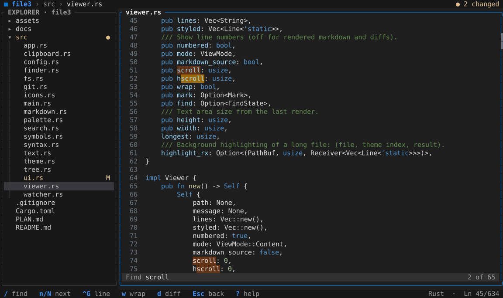

# file3

A fast terminal app for **reading** code, built to replace VS Code when you only need to look
around a project: browse files, search, and see what changed. It does not edit files.



## Features

- **File tree** – the whole project as an explorer tree; click or use the arrow keys, the file
  shows up on the right. Files from `.gitignore` are hidden (`h` shows them).
- **File preview** – syntax highlighting for 100+ languages, line numbers, rendered markdown.
- **Go to file** (`Ctrl+P`) – find a file by typing part of its name; recent files come first.
- **Search in files** (`Ctrl+F`) – search the whole project, with match case, whole word, regex
  and include / exclude filters (`Alt+F`).
- **Find in file** (`/`) – then `n` / `N` for the next / previous match.
- **Go to symbol** (`Ctrl+R`) – jump to a function, class or heading in the open file.
- **Go to line** (`Ctrl+G`), **back / forward** (`Alt+←` / `Alt+→`).
- **Live refresh** – files changed on disk (e.g. by an AI agent) update on screen by themselves.
- **Git changes** – changed files are marked `M`; `f` lists only them, `d` shows the diff.
- **Copy path** (`y`, or `Y` with the line number) and **open in your editor** (`e`).
- **Command palette** (`F1`) – every action in one searchable list.
- **Color themes** – Dark Modern, Material Palenight, One Dark, Light Modern (`F1` → Color Theme).
- **Remembers** your settings and, per project, the open file, expanded folders and recent files.
- **Mouse** – click, double-click, scroll, drag the panel border to resize.

Press `?` in the app for all keys.

## Install

```bash
# Install (makes `file3` available everywhere)
cargo install --path .
# Update after pulling changes
cargo install --path . --force

# Run in the folder you want to browse
file3
```

## Keys

| Key                    | Action                                    |
| ---------------------- | ----------------------------------------- |
| `F1`                   | All commands, color theme, settings       |
| `Ctrl+P`               | Go to file                                |
| `Ctrl+F`               | Search in all files                       |
| `Ctrl+R`               | Go to symbol in file                      |
| `Ctrl+G`               | Go to line                                |
| `Alt+←` `Alt+→`        | Back / forward                            |
| `Tab`                  | Switch between explorer and file          |
| `↑` `↓` / `j` `k`      | Move / scroll                             |
| `→` `←`                | Expand / collapse folder; scroll sideways |
| `Enter`                | Open folder or focus file                 |
| `PgUp` `PgDn`          | Scroll the file                           |
| `Home` `End` / `g` `G` | Top / bottom                              |
| `/` then `n` `N`       | Find in file, next / previous             |
| `w`                    | Wrap long lines                           |
| `m`                    | Markdown preview / source                 |
| `y` / `Y`              | Copy path / path with line                |
| `e`                    | Open in editor                            |
| `h`                    | Show gitignored files                     |
| `f`                    | Only changed files (git)                  |
| `d`                    | Diff vs `HEAD` (git)                      |
| `r`                    | Reload from disk                          |
| `i`                    | Nerd Font file icons                      |
| `Esc`                  | Close / clear highlight / go back         |
| `q`                    | Quit                                      |

In the search panel: `Alt+C` match case, `Alt+W` whole word, `Alt+R` regex, `Alt+F` filters.

## Settings

Saved automatically in `%APPDATA%\file3\config.toml` (Linux/macOS:
`~/.config/file3/config.toml`); `F1` → *Open Settings File* opens it.

```toml
theme = "Material Palenight"
nerd_font = true
wrap = false
# command for `e`; {file} and {line} are filled in
editor = "code --goto {file}:{line}"
```

## Tips

- **File icons** need a [Nerd Font](https://www.nerdfonts.com/) as the terminal font. file3 comes
  with one (CaskaydiaCove NFM): press `i`, and if the font is missing file3 offers to install it
  and, in Windows Terminal, to make it the terminal font. Restart the terminal afterwards.
  `file3 --install-font` installs it without the prompts. The font is under the SIL Open Font
  License, see [assets/font/LICENSE](assets/font/LICENSE).
- **Selecting text with the mouse:** hold `Shift` while dragging.
- **Windows Terminal** keeps `Ctrl+Shift+F` and `Ctrl+Shift+P` for itself; use `Ctrl+F` and `F1`.
- The screenshot is generated from a real render: `cargo test write_screenshot -- --ignored`.

## Requirements

- Rust 1.82+
- A terminal with true color support
- Git (only for change markers and diffs)
